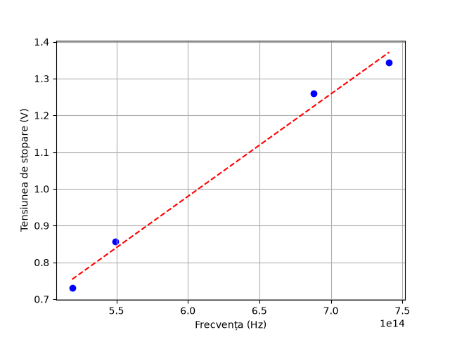

# Rezumat: Determinarea Constantei lui Planck din Studiul Efectului Fotoelectric

## 1. Scopul Lucrarii
Verificarea legilor efectului fotoelectric extern si determinarea valorii constantei lui Planck ($h$) analizand dependenta liniara a tensiunii de stopare de frecventa radiatiei incidente.

## 2. Date Experimentale
Frecventele au fost calculate folosind relatia $\nu = \frac{c}{\lambda}$.

| Filtru | Lungime de unda $\lambda$ (nm) | Frecventa $\nu$ ($10^{14}$ Hz) | Tensiune de stopare $U_0$ (V) |
| :--- | :--- | :--- | :--- |
| Galben | 578 | 5.19 | 0.730 |
| Verde | 546 | 5.49 | 0.857 |
| Albastru | 436 | 6.88 | 1.259 |
| Violet | 405 | 7.41 | 1.343 |
| Ultraviolet | 366 | 8.20 | *1.230 (Anomalie - exclus din calcul)* |

## 3. Rezultate Obtinute
Pe baza regresiei liniare (metoda celor mai mici patrate) aplicate doar pe primele 4 puncte valide, s-au dedus urmatoarele constante fizice:
*   **Constanta lui Planck experimentala ($h$):** $4.46 \cdot 10^{-34}$ J·s
*   **Lucrul mecanic de extractie ($L_{extr}$):** 0.69 eV
*   **Frecventa de prag ($\nu_p$):** $2.48 \cdot 10^{14}$ Hz

---

---

## 4. Concluzii
Experimentul valideaza principiul fundamental al efectului fotoelectric: energia electronilor extrasi creste liniar cu frecventa fotonilor incidenti. Punctul de date corespunzator filtrului ultraviolet a fost exclus din calcule, intrucat tensiunea sa de stopare inferioara reprezinta o eroare experimentala evidenta. Valoarea obtinuta de noi pentru constanta lui Planck difera de valoarea reala a acesteia ($6.626 \cdot 10^{-34}$ J·s) din cauza erorilor umane si a echipamentului utilizat.